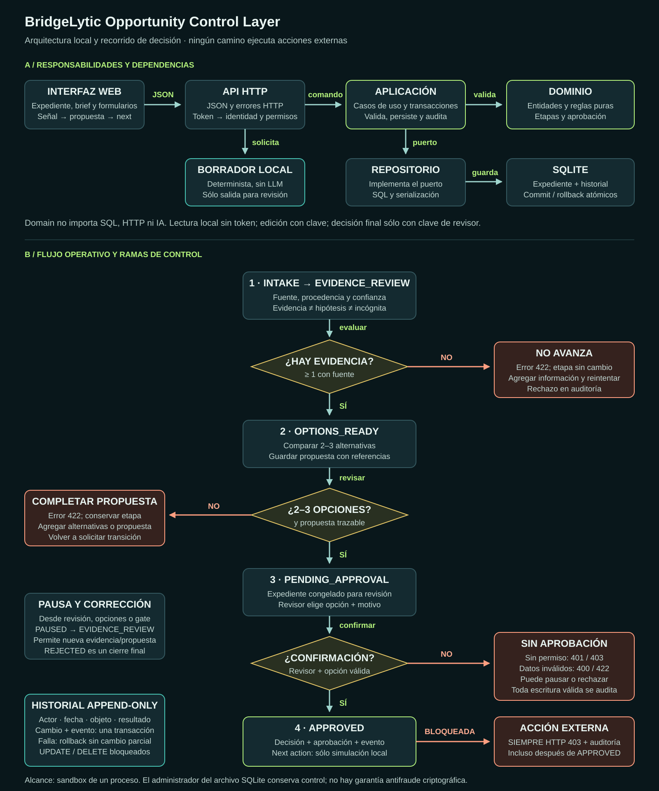

# Arquitectura

[Abrir el diagrama completo](ARQUITECTURA.svg)

La vista superior separa componentes; la inferior explica el flujo operativo. Las
flechas naranjas representan rechazo o bloqueo, no ejecución externa.

## Responsabilidades

La web envía JSON a HTTP. El adaptador HTTP resuelve la identidad y los permisos;
la aplicación coordina validaciones de dominio, persistencia y auditoría mediante
puertos. SQLite implementa esos puertos. El dominio no depende de SQL, HTTP ni IA.

La generación local sólo devuelve un borrador. Nunca llega directamente a aprobación.
El revisor confirma opción, motivo y versión de propuesta. Escritura y evento se
confirman juntos; ante una falla se revierten juntos.

## Decisiones de diseño

Python estándar reduce dependencias del entorno reproducible. SQLite permite demostrar
atomicidad y claves foráneas sin infraestructura externa. Un servidor de una sola
solicitud a la vez evita compartir transacciones concurrentes en la misma conexión.
Se conserva control de etapa esperada para detectar actualizaciones inconsistentes.

Las entidades inmutables reducen cambios accidentales; módulos separados distinguen
reglas, casos de uso, adaptadores y presentación. Los mixins de workflow agrupan el
recorrido vertical sin introducir una segunda conexión o un segundo servicio.

La arquitectura no incluye conectores productivos. Antes de producción se requieren
identidades corporativas, despliegue autorizado, respaldos, monitoreo y controles
adicionales descritos en [Seguridad y operación](SEGURIDAD_Y_OPERACION.md).
